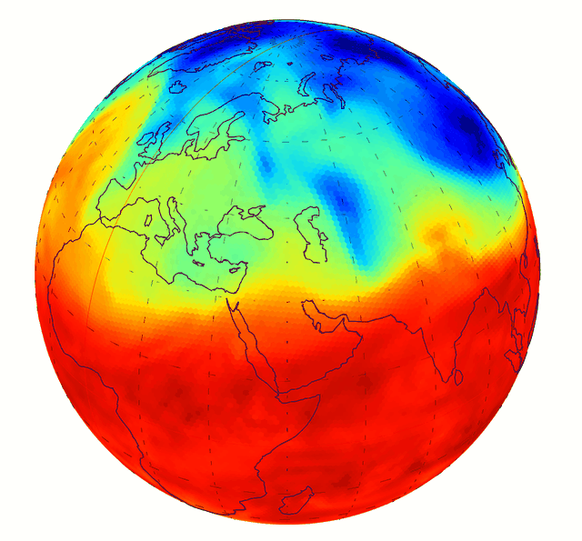
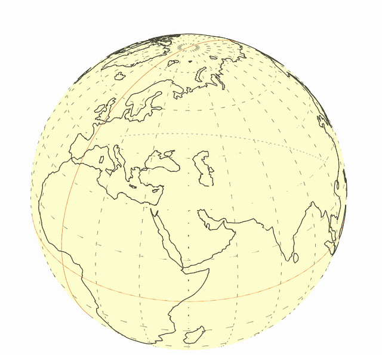
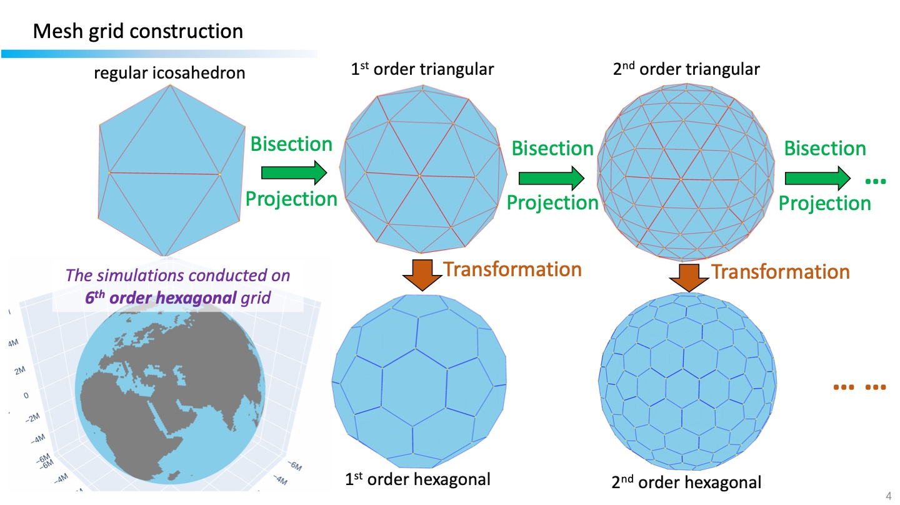

# Finite-Volume Advection on Spherical Geodesic Grids

A Python implementation of temperature and tracer transport on the sphere, from geodesic mesh construction to a first-order finite-volume solver. CS555 final project, University of Illinois Urbana-Champaign, Spring 2024. By Wenhan Tang.

<table>
  <tr>
    <th width="50%">Temperature advection</th>
    <th width="50%">Aircraft CO₂ plume</th>
  </tr>
  <tr>
    <td></td>
    <td></td>
  </tr>
  <tr>
    <td>A 24-hour simulation of temperature transport at 500 hPa, initialized and driven by ECMWF reanalysis data.</td>
    <td>A moving source along a great-circle route from Chongqing to Munich. The emitted CO₂ is carried eastward by the winds.</td>
  </tr>
</table>

[Presentation with animations](https://tangwhiap.github.io/spherical-advection/) · [Slides (PDF)](docs/presentation/slides.pdf) · [PowerPoint](https://github.com/tangwhiap/spherical-advection/releases/download/presentation/CS555_presentation.pptx) · [Notebook](miniapp_topic.ipynb)

## Key points

- Construct triangular geodesic meshes by recursively subdividing an icosahedron and projecting vertices onto the sphere, then form the dual mesh of hexagonal cells and 12 pentagonal cells.
- Compute upwind fluxes from wind components normal to cell edges. Each shared-edge flux enters its two neighboring cells with opposite signs.
- Use the same solver for idealized transport tests, atmospheric temperature evolution, and a moving CO₂ emission source.
- Interpolate reanalysis winds onto the mesh and visualize the resulting fields in 3D with Plotly.

## Spherical mesh

Each refinement splits a triangular face into four smaller triangles. The dual construction connects the surrounding triangle centers to form the transport cells. Scalar quantities are stored at cell centers and winds are evaluated at edge centers. The two atmospheric examples use a sixth-order mesh with 40,962 cells.

## Advection scheme

The solver advances the conservative transport equation

$$
\frac{\partial q}{\partial t} + \nabla \cdot (q\mathbf{u}) = S.
$$

For each time step, it projects the wind onto each edge normal, selects the upstream cell value, and sums the edge fluxes into cell-integrated quantities using a sparse matrix. Time integration is explicit, with the step size set from a Courant number.

The temperature example transports air density $\rho$ and $\rho T$ separately, then recovers $T$. The aircraft example transports CO₂ density with a source of 2.19 kg/s moving along the flight path. These are two-dimensional advection experiments; vertical motion and additional heating or cooling are omitted. The first-order scheme introduces numerical diffusion.

## Code

| File | Contents |
| --- | --- |
| [miniapp_topic.ipynb](miniapp_topic.ipynb) | Mesh generation, idealized tests, atmospheric examples, and plotting |
| [src/sphere_mesh.py](src/sphere_mesh.py) | Mesh construction, connectivity, cell geometry, NetCDF I/O, and 3D plotting |
| [src/advection.py](src/advection.py) | Edge fluxes and finite-volume updates |
| [src/real_scenarios.py](src/real_scenarios.py) | Reanalysis input, temperature transport, and aircraft emissions |
| [src/ideal_scenarios.py](src/ideal_scenarios.py) | Prescribed initial conditions and wind fields for transport tests |
| [src/experiment.py](src/experiment.py) | Scenario setup and time integration |

Running the notebook

The notebook contains the original experiment workflow. Install its dependencies with `python -m pip install -r requirements.txt`, then open `miniapp_topic.ipynb` in Jupyter from the repository root.

Input data and generated mesh files are excluded from this repository. The notebook expects `data/ERA5-pl-global.nc` with temperature and horizontal winds at 500 hPa, `data/coastlines.json`, and `data/landocean_hexagon_order{4,5,6}.npy`. The atmospheric cases use hourly fields from January 1–2, 2013. Meshes are generated in the notebook and cached in `meshgrid/`; figures are written to `plots/`.

The notebook was developed with Python 3.7. Its cells and the solver retain the original implementation; saved notebook outputs have been cleared. The animations and slides above can be viewed without running the simulations.

## License

[MIT](LICENSE).
